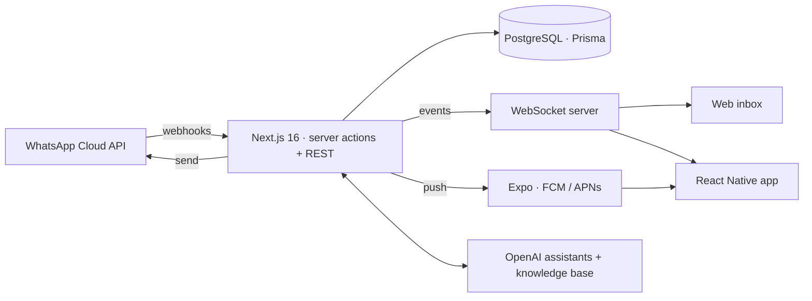

**Full-stack engineer from Sialkot, Pakistan.** I design it, build it, ship it and keep it running in production.

<!--  -->

---

## Now shipping

### TalkWhy — the WhatsApp Business inbox for teams
**[talkwhy.com](https://talkwhy.com)** · web app + Android app (iOS coming) · live in production

One shared WhatsApp number, a whole team answering it, and an AI that handles the easy questions.

| | |
|---|---|
| **Shared team inbox** | Assignment, statuses, tags, contact lists, 24-hour-window aware composer, real-time sync across web and phone |
| **AI agent** | Assistant trained on each business's website and documents, auto-replies, translation both ways |
| **Templates & broadcasts** | Meta template builder with media headers, scheduled and recurring broadcasts, delivery tracking |
| **Mobile app** | React Native (Expo) with push notifications, voice notes, media, and the full inbox in your pocket |
| **Help desk** | Built-in support tickets with screenshots, SLA timers, internal notes and per-user blocking |
| **Platform** | Team roles and fine-grained permissions, public REST API with scoped keys, subscriptions and billing |

### CaffStack
**[caffstack.com](https://caffstack.com)** · where I write about and teach the stack I use every day.

---

## How I work

- **Own the whole path.** Schema, API, UI, mobile, deploys, monitoring — one person, no hand-off gaps.
- **Run what I build.** Ubuntu + Nginx + PM2 clusters on AWS, zero-downtime reloads, live debugging from logs and the database.
- **Security is a feature.** RBAC, scoped API keys, rate limits, content-checked uploads, field-level encryption where data is sensitive.
- **Real-time by default.** WebSockets and push so screens never need a refresh.

---

## Stack

  
   
  

| Area | Tools |
|---|---|
| **Web** | Next.js · React · Tailwind · Zustand · Inertia · Livewire |
| **Mobile** | React Native · Expo · EAS · push notifications |
| **Backend** | NestJS · Node/Express · Ruby on Rails · Laravel · Flask |
| **Data** | PostgreSQL · Prisma · MongoDB · Redis · Sidekiq |
| **Real-time** | WebSockets · Socket.IO · ActionCable |
| **AI & APIs** | OpenAI · WhatsApp Cloud API · Firebase · Stripe · Paymob |
| **Infra** | AWS (EC2, S3) · Nginx · PM2 · Cloudflare · Ubuntu |

---

## Also built

- **Real-time microservices platform** — Rails API, NestJS services, a Python AI service and a Next.js front end over WebSockets, with RBAC, background jobs and encrypted sensitive fields.
- **Offline-first point of sale** — Laravel + Inertia + React with IndexedDB sync, barcode scanning and thermal printing.
- **E-commerce storefronts** — Next.js + Prisma + PostgreSQL with auth, admin panels and payments.
- **CMS, ERP and internal tools** — content platforms on Laravel + Livewire, accounting and admin systems.

Most client work lives in private repositories. Happy to walk through architecture and code on request.

---

**Open to building products where I own the stack from database to production.**

<a href="mailto:hassanali.naeem9811@gmail.com">hassanali.naeem9811@gmail.com</a>

