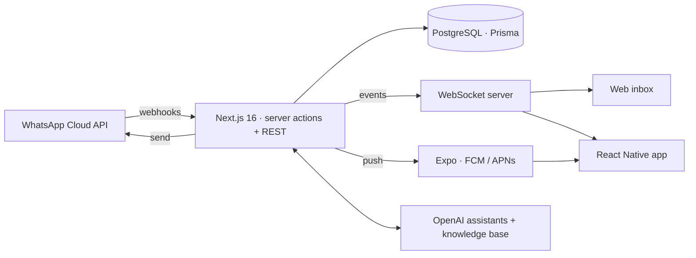

**Full-stack engineer and tech lead from Sialkot, Pakistan.** I design it, build it, ship it and keep it running in production.

<!--  -->

---

## Flagship products

| Product | What it is | Status |
|---|---|---|
| **[Biizay](https://biizay.com)** | Online store, point of sale and website in one account for businesses in Pakistan and the UAE. Till sales and the web shop share one stock; bookings and quotes for service businesses; profit reporting; run the whole store by chatting with AI. | Live |
| **[TalkWhy](https://talkwhy.com)** | The WhatsApp Business inbox for teams: one number, a whole team answering it, and an AI agent handling the easy questions. Web app plus Android app. | Live |
| **[Neoviya](https://neoviya.com)** | An AI assistant for B2B service firms that prepares quotes, invoices, payment reminders, LinkedIn prospecting, email triage and scheduling. Nothing is sent until you approve it. | Launching Dec 2026 |

### Inside TalkWhy

| | |
|---|---|
| **Shared team inbox** | Assignment, statuses, tags, contact lists, a 24-hour-window aware composer, real-time sync across web and phone |
| **AI agent** | Assistant trained on each business's website and documents, auto-replies, two-way translation |
| **Templates & broadcasts** | Meta template builder with media headers, scheduled and recurring broadcasts, delivery tracking |
| **Mobile app** | React Native (Expo) with push notifications, voice notes, media and the full inbox |
| **Help desk** | Built-in support tickets with screenshots, response targets, internal notes and per-user blocking |
| **Platform** | Team roles and fine-grained permissions, public REST API with scoped keys, subscriptions and billing |

---

## Platforms I lead for clients

### Tetraseven — multi-tenant e-commerce engine
**Tech lead · DevOps · CI/CD**

One instance runs a whole family of storefronts, each with its own domain, catalogue and branding, including **[mafson.co.uk](https://mafson.co.uk)**, **[zalwanltd.co.uk](https://zalwanltd.co.uk)** and the Tetraseven stores across the UK, US, Pakistan and Canada. I own the architecture, the deployment pipeline and the servers they run on.

### Caff Air — multi-tenant travel agency SaaS
**[caff-air.com](https://caff-air.com)**

Each travel agency gets its own branded portal on its own subdomain: client management and a traveller portal, bookings and packages, group air tickets, Umrah and tourism packages, with subscriptions and billing built in.

### Also built
- **Multi-tenant ERP and POS** — bilingual (Arabic/English), online and offline, for retail across MENA.
- **Real-time microservices SaaS** — Rails API, NestJS services, Python AI and PDF-signing services and a Next.js front end, with RBAC, background jobs and encrypted sensitive fields.
- **Blogging, CMS and directory platforms** — headless content systems with multi-blog management and SEO tooling.

Client repositories are private. Happy to walk through architecture and code on request.

---

## How I work

- **Own the whole path.** Schema, API, UI, mobile, deploys, monitoring. One owner, no hand-off gaps.
- **Multi-tenant by design.** One codebase, many businesses, each isolated by data, domain and permissions.
- **Run what I build.** CI/CD pipelines, Ubuntu + Nginx + PM2 on AWS, zero-downtime reloads, debugging live from logs and the database.
- **Security is a feature.** RBAC, scoped API keys, rate limits, content-checked uploads, field-level encryption where data is sensitive.
- **Real-time by default.** WebSockets and push, so screens never need a refresh.

---

## Stack

  
   
  

| Area | Tools |
|---|---|
| **Web** | Next.js · React · Tailwind · Zustand · Inertia · Livewire |
| **Mobile** | React Native · Expo · EAS · push notifications |
| **Backend** | NestJS · Node/Express · Ruby on Rails · Laravel · Flask |
| **Data** | PostgreSQL · Prisma · MongoDB · Redis · Sidekiq |
| **Real-time** | WebSockets · Socket.IO · ActionCable |
| **AI & APIs** | OpenAI · WhatsApp Cloud API · Firebase · Stripe · Paymob |
| **Infra & delivery** | AWS (EC2, S3) · Nginx · PM2 · Cloudflare · Ubuntu · CI/CD |

---

**Open to building products where I own the stack from database to production.**

<a href="mailto:hassanali.naeem9811@gmail.com">hassanali.naeem9811@gmail.com</a>

